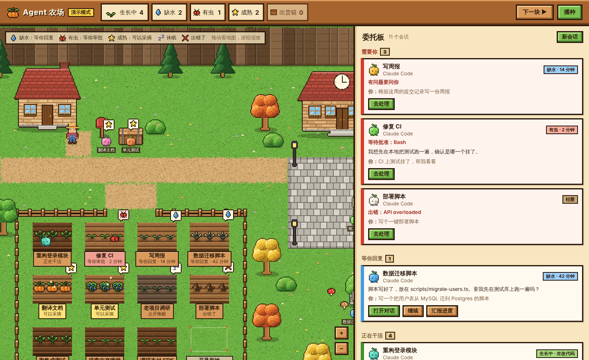
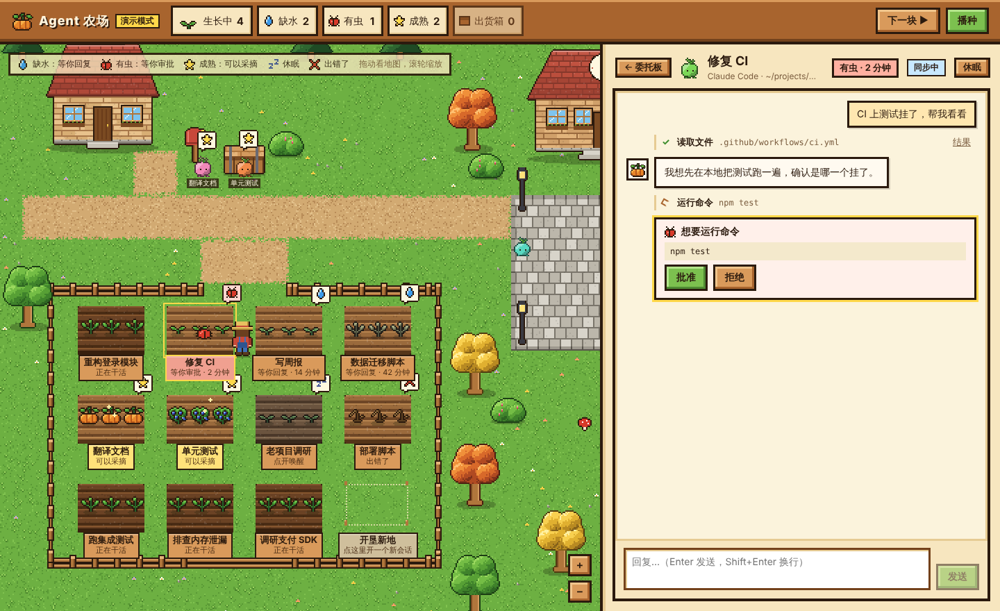

# Stardew Agent

星露谷风格的 AI agent 会话管理面板。每个 Claude Code 会话是农场里的一块地：

- 🌱 **生长中**：agent 在思考、在干活
- 💧 **缺水**：在等你回复（等得越久，植物越蔫）
- 🐛 **有虫**：在等你审批权限
- 🎃 **成熟**：会话结束，可以采摘归档
- 💤 **休眠**：进程没在跑，点一下就能接着上次的对话

每个会话还有一只自己颜色的**祝尼魔**，按它此刻在做的事在小镇里走动：改代码在田里、跑命令去铁匠铺、查资料去博物馆、搜文件下矿洞、需要你的时候在广场上举着「！」等你，一轮做完就回小屋歇着。

右边是**委托板**：所有会话按「需要你 → 等你回复 → 正在干活 → 休息中」排好，卡片上能直接点「继续」「汇报进度」。点进去就是这个会话的对话界面：直接聊天、批准操作、回答 Claude 的选择题，不用碰终端，也不用在一堆窗口之间来回切。





> 目前处于第一阶段：支持 Claude Code。Codex、知识库、睡觉模式、金币商店等在路线图里，见 [设计文档](docs/DESIGN.md)。

## 它怎么工作

- 每块地运行的是**你自己安装的、原版的 `claude` 命令行程序**。登录走 Claude Code 自己的流程，这个 app 不读取、不保存任何账号凭证。
- 状态来自 Claude Code 官方的 hooks：启动会话时通过 `--settings` 传入一份只对该会话生效的配置，**不会改动你的全局设置**。
- 可选开启 Remote Control：同一个会话也能在 claude.ai/code 和手机 Claude app 上实时查看、回复（需要 Pro / Max / Team / Enterprise 订阅登录）。
- 关掉窗口时农场缩到托盘，会话继续跑。从托盘退出后会话停止，下次打开可以唤醒（`claude --resume`）。

## 运行

需要：

- Node.js 20 或更新版本
- 已安装并登录 [Claude Code](https://code.claude.com/docs)，在终端里能直接运行 `claude`

```bash
npm install
npm run dev
```

Windows 上不用装 Visual Studio 编译工具，终端组件 node-pty 自带 Windows 预编译版本。

如果 app 找不到 `claude`（比如装在不常见的位置），可以用环境变量指定：

```bash
# macOS / Linux
STARDEW_CLAUDE_PATH=/path/to/claude npm run dev
# Windows PowerShell
$env:STARDEW_CLAUDE_PATH="C:\path\to\claude.exe"; npm run dev
```

### 只看界面（演示模式）

```bash
npm run web
```

在浏览器打开 http://localhost:5173 ，会看到一个模拟的农场，不会连接任何真实的 agent。

## 开发

```bash
npm run typecheck   # 类型检查
npm test            # 单元测试 + 用模拟 claude 跑的端到端测试
npm run build       # 构建到 out/
```

目录结构和设计决定见 [docs/DESIGN.md](docs/DESIGN.md)。

## 说明

- 美术是原创的像素画，风格参考星露谷物语，没有使用其素材。本项目与 ConcernedApe、Anthropic 均无关联。

## 许可证

Copyright 2026 JarvisZhao

代码以 [Apache License 2.0](LICENSE) 开源：任何人都可以使用、修改、分发（包括商用），但要保留版权和许可声明、注明改动。许可证不授予项目名称或标志的商标使用权。
